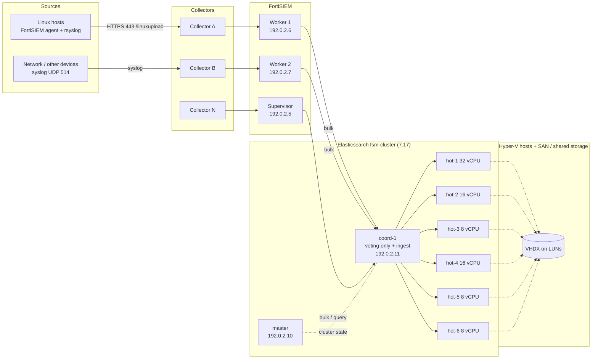
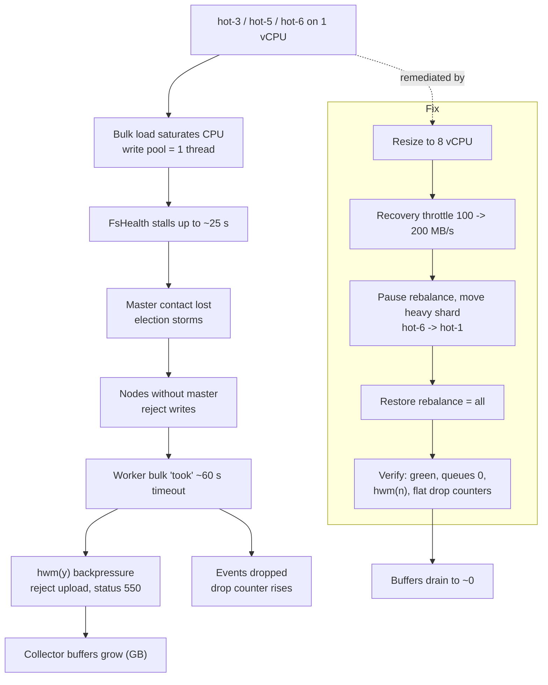
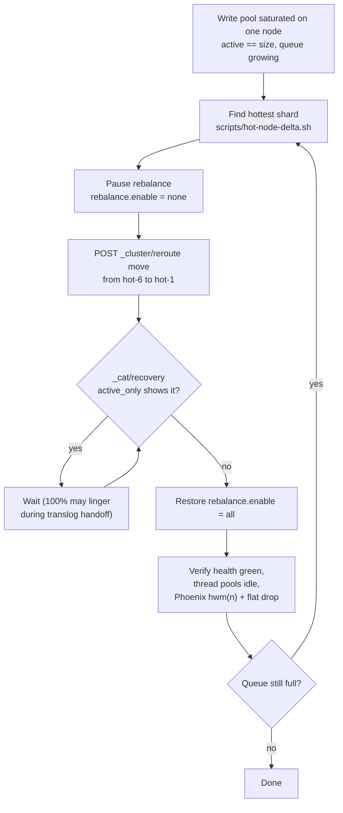
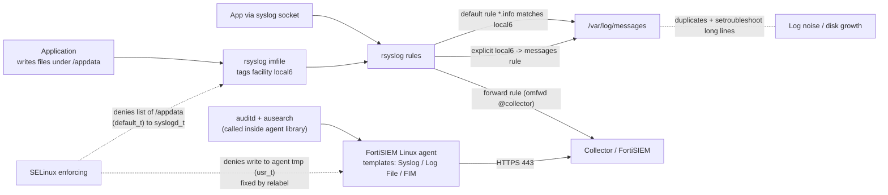
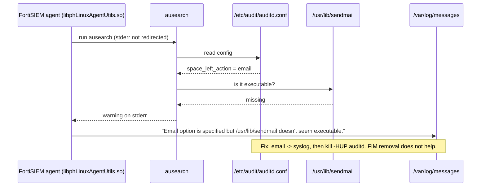
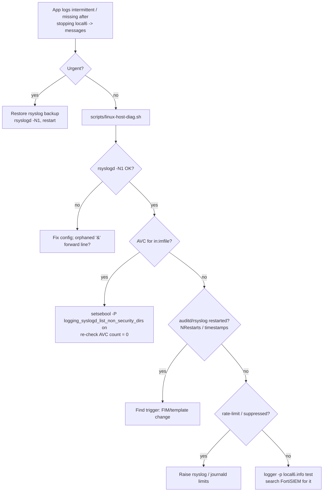

# FortiSIEM + Elasticsearch Ops Runbooks

Sanitized notes, commands, scripts and diagrams from running **FortiSIEM 7.4.x** on an **Elasticsearch 7.17** hot cluster, plus **Linux agent / rsyslog / SELinux / auditd** troubleshooting on RHEL hosts.

> All IPs, hostnames, collector names, org IDs and customer paths are placeholders (`192.0.2.x` per RFC 5737, `<...>`, `prd-web-01`, `/appdata`). Replace them before use and review every command before running it in production. Nothing here is vendor documentation; Fortinet and Elastic links are in `docs/fortinet-references.md`.

## 1. What this repo is for

It records what we did, why, and how to repeat it:

1. **An ingestion incident**: Elasticsearch nodes stalled, FortiSIEM Workers rejected uploads and dropped events. Root cause, fix and verification are in `docs/incident-es-ingestion.md`.
2. **A platform audit** of the ES cluster, VMs and storage, with prioritized findings (`docs/platform-audit-findings.md`) and still-open items (`docs/open-items.md`).
3. **Linux agent noise and log-ingestion issues** on RHEL: a flooding auditd/sendmail warning, SELinux denials, duplicate lines, and app logs that became intermittent after an rsyslog change.

## 2. Platform architecture

Events flow from sources through Collectors to FortiSIEM Workers/Supervisor, which bulk-write into Elasticsearch. ES nodes are Hyper-V guests on shared storage, so CPU, disk and storage latency all affect ingestion. (Simplified: which Collector feeds which Worker depends on the deployment.)



Key design facts:
- **Placement by shard count, not CPU.** All six data nodes carry `box_type: hot`; ES spreads shards evenly, so heavy daily indices can land on weak nodes.
- **Write thread pool size = vCPU count.** A 1-vCPU node has a single write thread and stalls under load.
- **FortiSIEM owns index names and rollover** (`fortisiem-event-<date>-<orgId>-00000N`); we do not roll indices manually.
- **Almost no replicas**, so a data-node outage fails writes for its primaries and a lost VHDX loses data.

## 3. The incident in one picture

Three hot nodes ran on 1 vCPU. Under bulk load they stalled, lost the master, and nodes without a master reject writes. Workers then hit their ~60 s bulk timeout, switched on backpressure (`hwm(y)`), refused collector uploads (status 550) and dropped events. Collector buffers grew to GBs.



Impact: ~1.2M events lost in ~2.5 h on day 1, ~55k around a later resize, ~46k on the Supervisor between two checks on day 2.
Fix: resize to 8 vCPU, raise recovery throttle to 200 MB/s, pause rebalance, move the heaviest shard off the saturated node, restore rebalance, verify.
Lessons (details in the incident doc): restore rebalance only after recoveries finish; do not assume node roles from letters (check `_cat/nodeattrs`); `export ES_URL` in every new shell.

### Relieving a saturated node (runbook)

Use when a node's write pool shows `active == size` with a growing queue. Commands are in `elasticsearch/cheatsheet.md`; the shard-delta script finds the busiest shard.



### Healthy vs unhealthy, how to tell

| Signal | Healthy | Problem |
|---|---|---|
| `_cluster/health` | green, 0 relocating, 0 unassigned | yellow/red, stuck relocations |
| write pool (`_cat/thread_pool/write`) | active low, queue 0, rejected 0 | active == size, queue growing |
| Phoenix stats (Super/Workers) | `hwm(n)`, drop counter flat | `hwm(y)`, counter rising |
| Collector Health | buffers ~0 MB | buffers growing, Last File Received stale |
| Node disk | < 70% | approaching 75/85/90% watermarks |

## 4. Platform audit (what we checked and found)

Run `scripts/audit-cluster.sh` (cluster level, any shell with `ES_URL`) and `scripts/audit-node.sh` (per VM), then review Hyper-V/SAN with the checklists in `infra/`. Highlights, most important first:

1. **No replicas and no confirmed snapshots**: add a snapshot repository + policy and/or replicas.
2. **ILM deletes at 90 d, not the intended 120 d**: confirm before first deletions.
3. **Smallest hot-node disk near the 75% low watermark**: extend or rebalance big shards.
4. **Weak nodes** (8 GB heaps, one near 67% heap).
5. **Possible single bulk endpoint** (coord-1): add more endpoints in the Workers' ES settings.
6. Smaller: odd cluster settings (`unsafe-bootstrap`, huge `search.max_buckets`), empty-index clutter, inconsistent 2-shard template, mixed node roles, no alerting, dead collectors.

Full list and the open checklist: `docs/platform-audit-findings.md`, `docs/open-items.md`.

## 5. Linux agent, rsyslog, SELinux, auditd

### Where logs go and where things break



### Problem A: "Email option is specified but /usr/lib/sendmail doesn't seem executable"

`ausearch` prints it whenever `auditd.conf` has an `email` action and no sendmail exists. The agent calls `ausearch` from inside its compiled library and does not redirect stderr, so the warning lands in `/var/log/messages` many times an hour. Removing a FIM path does not affect it.



Fix: change `email` to `syslog` in `auditd.conf`, then `kill -HUP $(pidof auditd)` (not `service auditd reload` when audit is immutable). Alternatives and the vendor email draft are in `linux-agent/auditd-sendmail-warning.md` and `templates/vendor-support-email.md`.

### Problem B: SELinux denials

- **Agent helper tools** (`ethtool`, `logrotate`) could not write to the agent's tmp folder (`usr_t`): fixed by relabeling the folder.
- **rsyslog `imfile` could not list the app log directory** (`default_t`, denied every ~10 s): app logs became intermittent because new/rotated files were not discovered. Fix with the standard boolean `logging_syslogd_list_non_security_dirs`, then check the AVC count is 0.
- Never set SELinux to permissive. Details: `linux-agent/selinux-denials.md`.

### Problem C: duplicates and the local6 change

The default RHEL rule `*.info;...  /var/log/messages` already matches `local6`, so an extra explicit local6 rule writes everything twice. Before stopping the copy, confirm ingestion does not depend on it. After we stopped it, logs turned intermittent; use this tree to find the cause:



Notes on templates, FIM, immutable audit mode and logrotate: `linux-agent/agent-template-and-fim.md`, `linux-agent/rsyslog-local6-notes.md`. `scripts/linux-host-diag.sh` collects all the evidence in one read-only run (it writes one test syslog line).

## 6. Repository map

| Path | What it contains |
|---|---|
| `docs/incident-es-ingestion.md` | RCA, timeline, losses, fixes, mistakes, verification checklist |
| `docs/platform-audit-findings.md` | Audit method, healthy items, prioritized findings |
| `docs/open-items.md` | Remaining actions as a checklist |
| `docs/diagrams.md`, `diagrams/` | All diagrams (Mermaid sources and SVGs) |
| `docs/fortinet-references.md` | Links to Fortinet/Elastic docs with short notes |
| `elasticsearch/cheatsheet.md` | Node layout and every ES command we used, with explanations |
| `elasticsearch/audit-and-recovery.sh` | Quick read-only cluster status |
| `fortisiem/phoenix-drop-monitoring.md` | Reading Phoenix stats, drop counters, `hwm`, collector buffers, alert ideas |
| `infra/hyperv-storage-checklist.md` | Hyper-V host/VM/disk review |
| `infra/san-storage-checklist.md` | SAN/LUN/MPIO/CSV review (generic; not run) |
| `scripts/audit-cluster.sh` | "Script A": cluster audit to `/tmp/audit_cluster.txt` |
| `scripts/audit-node.sh` | "Script B": per-VM audit to `/tmp/audit_<ip>.txt` |
| `scripts/phoenix-check.sh` | Drop counter / `hwm` / rejection count on Super or a Worker |
| `scripts/hot-node-delta.sh` | Fastest-indexing shards on a node (30 s sample) |
| `scripts/linux-host-diag.sh` | Linux agent/rsyslog/SELinux/auditd diagnostics |
| `linux-agent/*.md` | Sendmail warning, SELinux, local6, template/FIM notes |
| `templates/` | Vendor support email and customer WhatsApp drafts |

## 7. Quick start

```bash
export ES_URL="http://192.0.2.11:9200"        # set in every new shell, or curl fails with "URL malformed"
bash scripts/audit-cluster.sh                 # read-only cluster audit
bash scripts/phoenix-check.sh                 # on Super / each Worker, compare with your baseline
NODE=data-hot-6 bash scripts/hot-node-delta.sh   # find the busiest shard on a node
bash scripts/linux-host-diag.sh               # on an affected RHEL host (as root)
```

Record a baseline of each node's Phoenix drop counter before and after any change; the delta is the number of events dropped.

## 8. Caveats

- Scripts and diagrams are generic; adapt names, IPs, node counts and paths.
- SAN/Hyper-V commands and the 7.4.1-specific agent behavior were not all verified in this environment; items marked as suggestions or "not confirmed" in the docs are exactly that.
- Some conclusions are inferences (for example, that Linux process-execution events depend on the agent's `ausearch` calls). Treat them as hypotheses until tested on one host.
