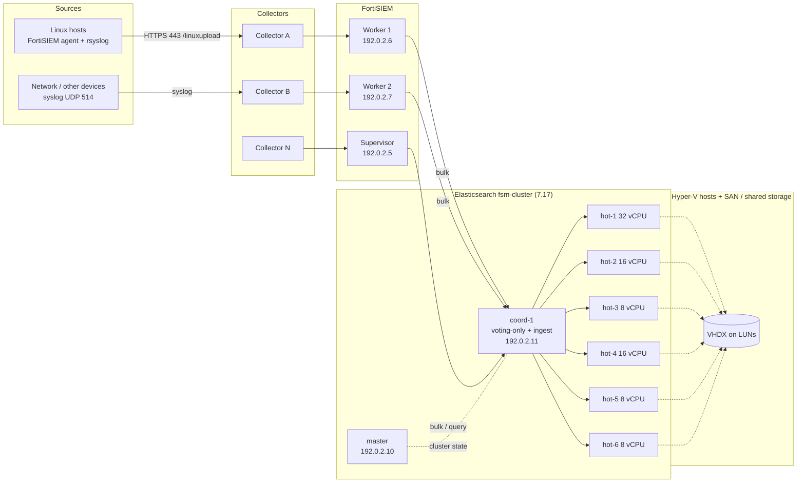
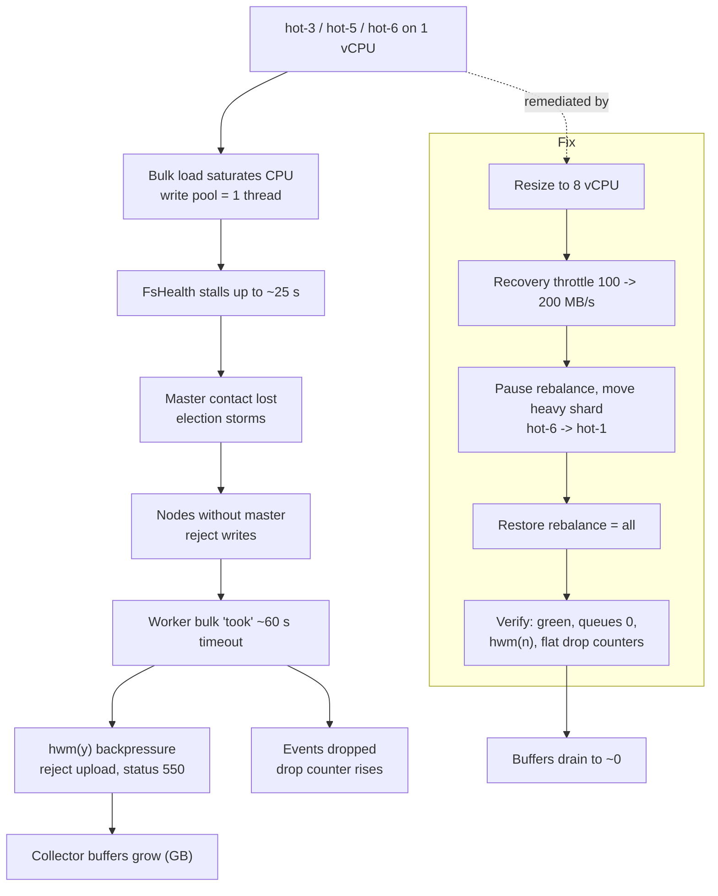
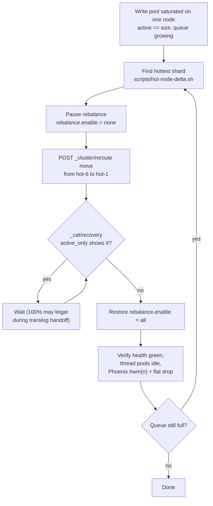
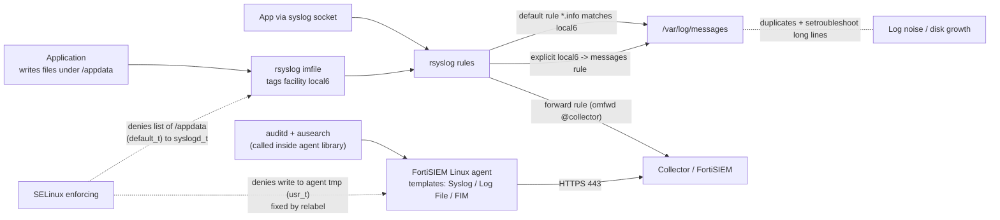
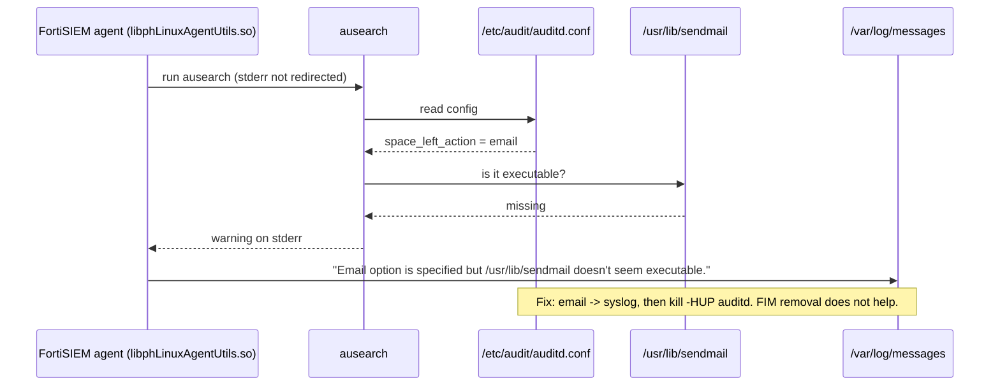
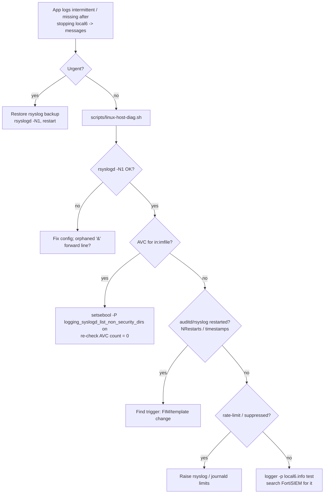

# Diagrams

GitHub renders the Mermaid blocks below. Rendered SVGs and sources live in `diagrams/`.
Architecture is simplified: which Collector feeds which Worker, and the exact Super/Worker roles, depend on your deployment.

## 1. Platform architecture (simplified; IPs are placeholders)

SVG: [`diagrams/01-architecture.svg`](../diagrams/01-architecture.svg)

## 2. Incident causal chain and fix

SVG: [`diagrams/02-incident-chain.svg`](../diagrams/02-incident-chain.svg)

## 3. Runbook: relieve a saturated hot node

SVG: [`diagrams/03-shard-move-runbook.svg`](../diagrams/03-shard-move-runbook.svg)

## 4. Linux host log paths and where SELinux blocks

SVG: [`diagrams/04-linux-log-paths.svg`](../diagrams/04-linux-log-paths.svg)

## 5. Why the sendmail warning appears

SVG: [`diagrams/05-sendmail-warning.svg`](../diagrams/05-sendmail-warning.svg)

## 6. Troubleshooting: app logs intermittent after local6 change

SVG: [`diagrams/06-local6-troubleshooting.svg`](../diagrams/06-local6-troubleshooting.svg)
